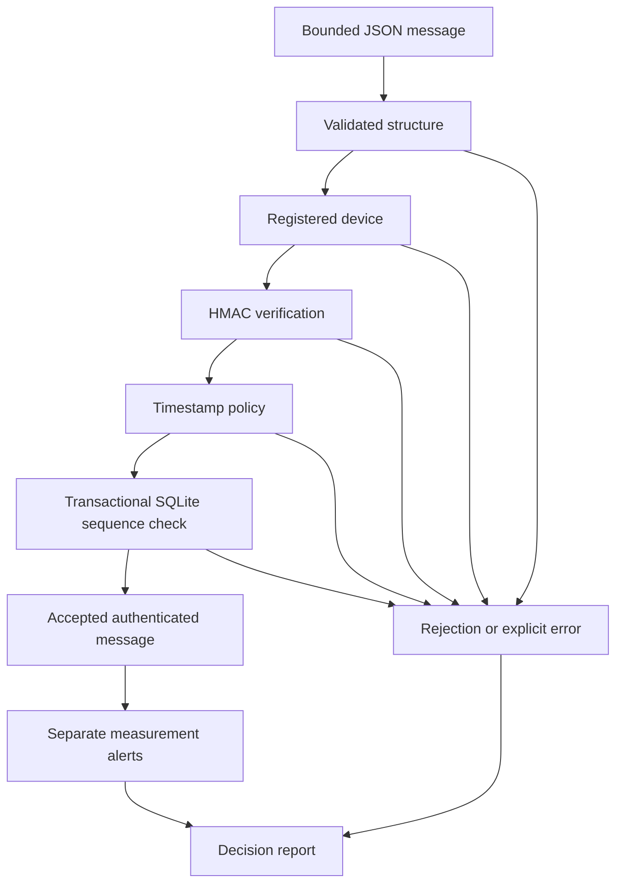

# IoT Telemetry Security Lab

Defensive offline validation of simulated IoT telemetry with HMAC-SHA256,
persistent replay detection and explainable decision reports.

An educational security-engineering project. No physical devices,
cloud deployment or live industrial system are required.

## Features

- Strict bounded JSON input and immutable validated messages.
- Explicit laboratory canonical representation for HMAC-SHA256.
- Constant-time signature comparison.
- Registered-device checks before signature verification.
- Timestamp freshness and future-tolerance checks.
- Transactional per-device sequence tracking in SQLite.
- Replay rejection across separate process executions.
- Measurement alerts separated from security rejection.
- Reports with input fingerprints, decisions and effective settings.
- Exclusive report export without overwriting existing files.

## Installation

Use Python 3.12 or newer on Linux, from the repository root.

```bash
python3 -m venv .venv
source .venv/bin/activate
python -m pip install -r requirements-dev.lock
python -m pip install --no-build-isolation --no-deps .
python -m pip check
```

There are no third-party runtime dependencies.
The development snapshot pins versions without package artifact hashes.

## Usage

Run the synthetic scenarios with fresh replay state:

```bash
mkdir -p reports
demo_directory=$(mktemp -d reports/telemetry-demo-XXXXXX)

iot-telemetry \
  --input data/synthetic/v1/messages.jsonl \
  --registry config/devices-demo.json \
  --state "$demo_directory/state.sqlite" \
  --evaluation-time "2026-01-01T00:00:00+00:00" \
  --output "$demo_directory/first.json"
```

Repeat using the same state and a new report destination:

```bash
iot-telemetry \
  --input data/synthetic/v1/messages.jsonl \
  --registry config/devices-demo.json \
  --state "$demo_directory/state.sqlite" \
  --evaluation-time "2026-01-01T00:00:00+00:00" \
  --output "$demo_directory/second.json"
```

The explicit evaluation time replays laboratory fixtures.
It is not a trusted production clock.

The demonstration registry contains public keys.
These keys must never be used to protect real devices.

Exit code 0 means analysis completed, including rejected messages.
Exit code 2 indicates an error or incomplete analysis.

## Architecture



Signatures and timestamps are checked before replay-state updates.
Rejected messages do not advance accepted sequence state.

## Observed Synthetic Results

Ten ordered scenarios were processed twice with the same SQLite state.

| Observation | First execution | Second execution |
| --- | ---: | ---: |
| Accepted messages | 2 | 0 |
| Rejected messages | 8 | 10 |
| Replay or out-of-order rejections | 2 | 4 |
| Measurement-alert records | 1 | 0 |

The first execution rejected modified payloads, incorrect signatures,
an unknown device, replay, stale/future timestamps and malformed JSON.

An authenticated temperature of 100 C was accepted with a separate
laboratory measurement alert.

These results verify the specified synthetic decisions.
They do not measure real-world attack coverage or industrial safety.

See [Evaluation](docs/evaluation.md).

## Quality Checks

```bash
python -m ruff check .
python -m ruff format --check .
python -m pytest -q
```

The latest observed local suite passed 50 tests.
Two separate installed-CLI executions demonstrated persistent replay rejection.

A clean Git clone and non-editable installation in a fresh Python 3.14 environment passed all 50 tests. Two installed-CLI executions reproduced the observed acceptance and persistent replay decisions.

Remote CI remains pending verification.

## Security Considerations

Analyze only authorized or synthetic telemetry.
Keep real keys, private telemetry and state databases outside public Git.

HMAC provides message authentication under a shared-secret assumption.
It provides neither confidentiality nor proof of measurement truth.

Accepted SQLite updates remain committed if report export subsequently fails.
Replay-state changes and report publication are not one atomic transaction.

See [Security Considerations](SECURITY.md).

## Limitations

- Public demonstration keys; no production key provisioning or rotation.
- Offline files, not MQTT transport.
- Laboratory-specific canonicalization, not a universal JSON standard.
- Strict sequence ordering rejects delayed legitimate messages.
- Device reboot or sequence reset requires explicit administrative handling.
- Lost or rolled-back SQLite state can permit replay within timestamp tolerance.
- Input and configuration files must remain stable while being read.
- Byte-bounded input is loaded into memory.
- SQLite database protection depends on the host and directory permissions.
- Path checks assume directories controlled by the current user.
- Hard-link export requires compatible local filesystem support.
- Measurement limits are illustrative, not industrial safety thresholds.
- A compromised device with its key can sign fabricated measurements.

## Future Work

- Add an isolated local MQTT transport.
- Define reviewed sequence-reset and key-rotation procedures.
- Improve state provisioning and filesystem permission controls.
- Measure contention, throughput and memory across larger workloads.
- Evaluate device-specific telemetry limits.
- Design recovery between committed state and report-publication failure.

## License

Distributed under the [MIT License](LICENSE).
